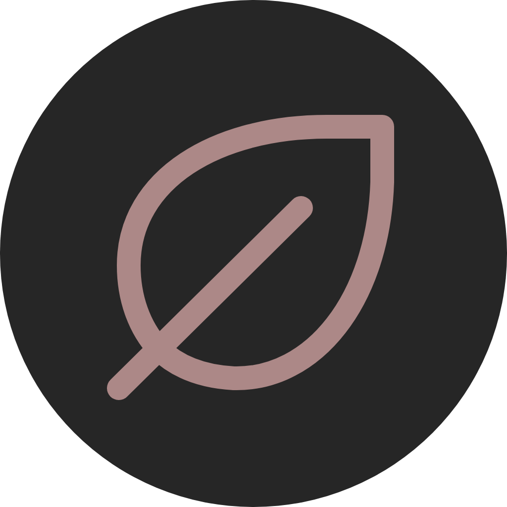
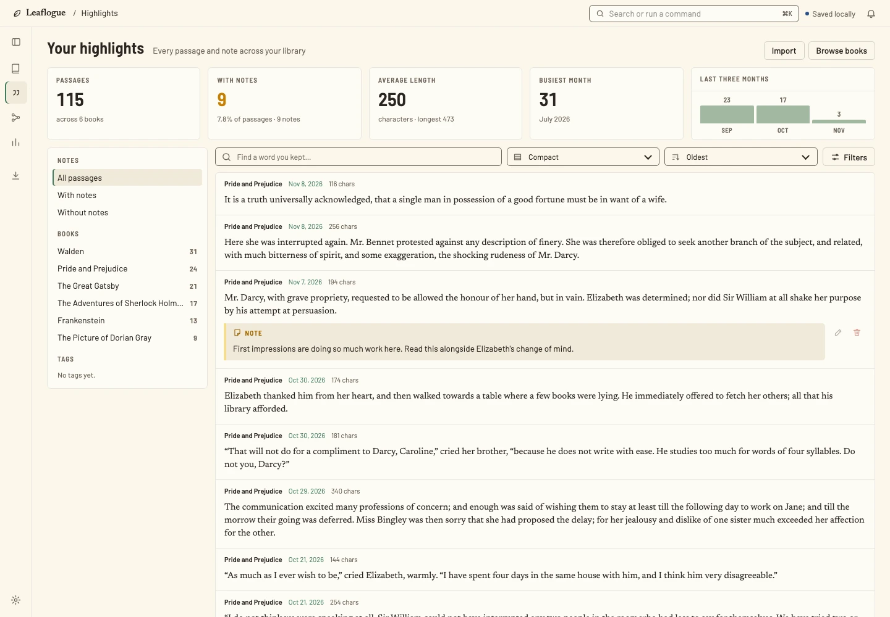
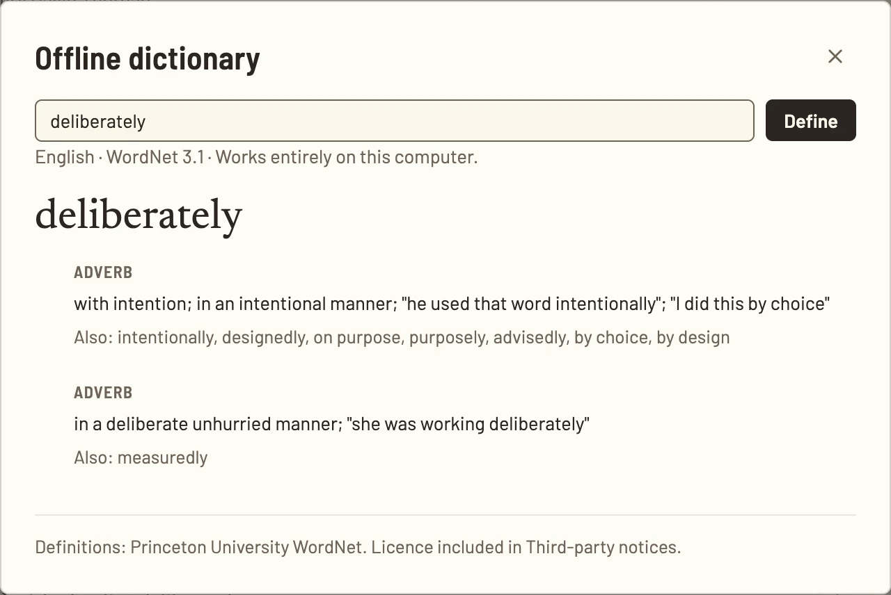
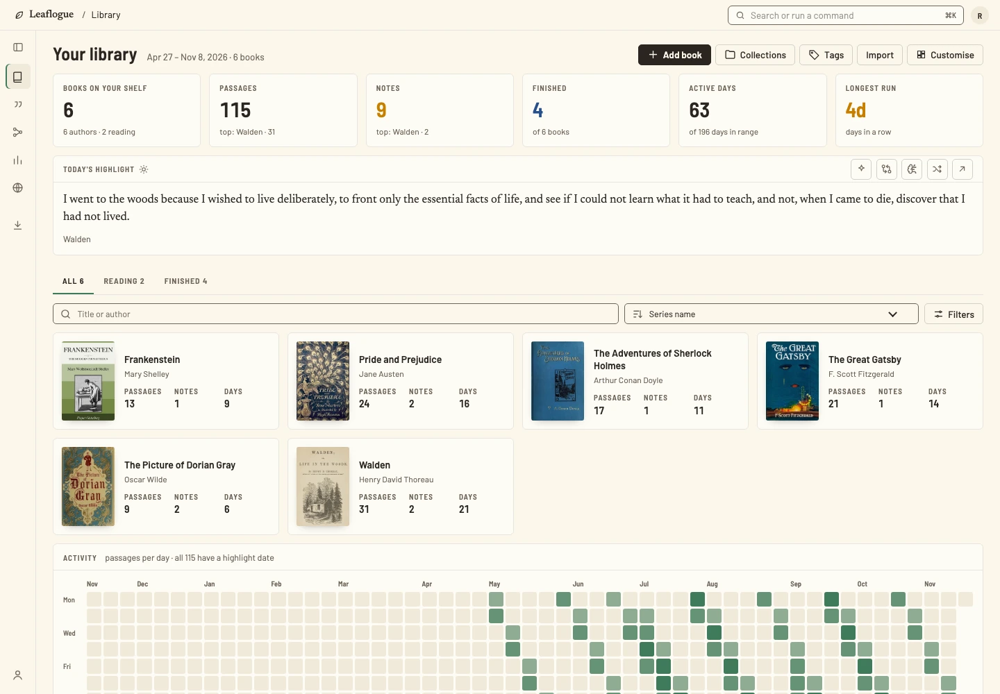

<p align="center">
  
</p>

<h1 align="center">Leaflogue</h1>

<p align="center">A home for the passages that stay with you.</p>

<p align="center">
  <a href="https://leaflogue-docs.vercel.app/">Website &amp; guides</a> ·
  <a href="https://github.com/Ka1Thakkar/leaflogue/releases">Downloads</a> ·
  <a href="CONTRIBUTING.md">Contribute</a> ·
  <a href="CHANGELOG.md">Changelog</a>
</p>

Leaflogue is an open-source, local-first library for your book highlights and
reading notes. Bring passages from your e-reader, connect ideas across books,
and return to what matters. Your desktop library works offline, without an
account. Sync and AI are optional.

<picture>
  <source media="(prefers-color-scheme: dark)" srcset="apps/docs/public/images/desktop-library-dark.webp">
  <source media="(prefers-color-scheme: light)" srcset="apps/docs/public/images/desktop-library-light.webp">
  
</picture>

## Make more of what you read

- **Bring your highlights together.** Import from Kobo, Kindle, KOReader,
  PocketBook, Tolino, Boox, or Leaflogue's portable JSON format. Review changes
  and conflicts before applying an import.
- **Give ideas a place to grow.** Add notes, organise books and passages with
  collections and tags, and build threads that connect passages across books.
- **Find your way back.** Search passages and notes, revisit a daily highlight,
  and explore your reading statistics.
- **Look up a word offline.** The desktop's bundled English dictionary needs
  neither an internet connection nor an AI key.
- **Make the space yours.** Choose light, dark, or system appearance, several
  built-in palettes, and a dashboard layout that suits your library.
- **Keep control of your data.** Desktop backups and exports stay in your hands.
  Optionally sync through your own PostgreSQL database or Convex deployment.
- **Explore a passage with AI, if you choose.** Configure your own provider and
  key. AI is off by default and is not required for reading or organising notes.

<table>
  <tr>
    <td width="50%"><strong>Passages and notes</strong></td>
    <td width="50%"><strong>Offline English dictionary</strong></td>
  </tr>
  <tr>
    <td valign="top">
      <picture>
        <source media="(prefers-color-scheme: dark)" srcset="apps/docs/public/salon/desktop-highlights-dark.webp">
        
      </picture>
    </td>
    <td valign="top">
      <picture>
        <source media="(prefers-color-scheme: dark)" srcset="apps/docs/public/salon/dictionary-dark.webp">
        
      </picture>
    </td>
  </tr>
</table>

Screenshots use a curated library of real published books and illustrative
reader notes, never a personal library. Sources and capture instructions are
in [`tests/marketing`](tests/marketing/README.md); dictionary credits are in
[`CREDITS.txt`](apps/docs/public/salon/CREDITS.txt).

## Get Leaflogue

**[0.1.1-beta.4 is available as an experimental beta](https://github.com/Ka1Thakkar/leaflogue/releases/tag/v0.1.1-beta.4).**
Automated checks and signed update-feed validation pass. Clean-desktop
installation, manual updates/uninstall,
and actual Orca, VoiceOver, and Narrator acceptance are still pending.
Back up your library before testing; keep another copy of irreplaceable data.

| Platform | Beta architecture | Downloads |
| --- | --- | --- |
| macOS 13+ | Apple Silicon, Intel | DMG, ZIP |
| Windows | x64; initial desktop acceptance on Windows 11 | Per-user installer, ZIP |
| Linux | x64, ARM64 | AppImage, tar.gz |

Use [GitHub Releases](https://github.com/Ka1Thakkar/leaflogue/releases) for
published downloads and checksums, and the
[installation guide](https://leaflogue-docs.vercel.app/start/install/) for setup.
Mac builds are ad-hoc signed without Apple notarization; Windows builds are
unsigned. OS trust prompts may block installation. Pending native and
accessibility acceptance is tracked in the
[beta release checklist](docs/beta-desktop-validation.md).

## Desktop and web, one library

The **desktop app** keeps its library in local SQLite. It works without a
server and supports file imports, backups, exports, connected-reader workflows,
and the offline dictionary. With sync enabled, changes made offline sync when
the connection returns; conflicting versions are retained for review.

The **self-hosted web app** gives you browser access to the same synced library,
including on smaller screens. It uses PostgreSQL through Leaflogue's API server,
or a Convex deployment. It requires a connection and authentication; desktop
file operations and the bundled dictionary remain desktop features.

<picture>
  <source media="(prefers-color-scheme: dark)" srcset="docs/assets/readme/web-library-dark.webp">
  
</picture>

You host the sync backend and web app yourself. Start with the
[sync guides](apps/docs/src/content/docs/sync/) or the
[web hosting guides](apps/docs/src/content/docs/web/).
Deployment variables are documented in
[`docs/configuration.md`](docs/configuration.md).

## Reader beta and next steps

**0.1.1-beta.4** adds a paged local EPUB reader, a right context sidebar,
read-only Calibre linking with EPUB/KEPUB choice and no duplicate files, shared library
highlights and notes, and navigation between a passage and its EPUB context.
Add book searches Google Books as you type, with Open Library fallback.
Desktop imports review existing books after sync, and Settings shows live sync
phases, transfer counts, and queued edits.
See the [reader guide](https://leaflogue-docs.vercel.app/library/epub/) and
[Calibre guide](https://leaflogue-docs.vercel.app/library/calibre/).

Book files, links, and reading positions remain local and are excluded from
SQLite backups and library exports. File sync and cross-device progress,
PDFs, bookmarks, book search, and richer match review remain follow-ups.
The opt-in read-only MCP server remains available; see the
[agent setup guide](apps/docs/src/content/docs/ai/mcp.md).

See the [versioned roadmap](docs/roadmap.md) and
[reader plan](docs/releases/0.1.1.md) for the longer-term scope.

## Build and run

This is an npm-workspace monorepo using Electron, React, TypeScript, and Astro.
Use the Node version in [`.nvmrc`](.nvmrc) and the npm version pinned in
[`package.json`](package.json).

```sh
git clone https://github.com/Ka1Thakkar/leaflogue.git
cd leaflogue
nvm install
nvm use
corepack enable npm
corepack install
npm ci
```

### Desktop

The following commands use a disposable development profile. Run them from a
POSIX shell, such as Terminal on Mac/Linux or Git Bash on Windows:

```sh
export LEAFLOGUE_DEV_ROOT="$(mktemp -d)"
export XDG_CONFIG_HOME="$LEAFLOGUE_DEV_ROOT/config"
export XDG_DATA_HOME="$LEAFLOGUE_DEV_ROOT/data"
export XDG_CACHE_HOME="$LEAFLOGUE_DEV_ROOT/cache"
export XDG_STATE_HOME="$LEAFLOGUE_DEV_ROOT/state"
unset LEAFLOGUE_CONFIG_FILE LEAFLOGUE_DATABASE_URL LEAFLOGUE_CONVEX_URL LEAFLOGUE_SYNC_PROVIDER
npm run dev --workspace @leaflogue/desktop -- -- --user-data-dir="$LEAFLOGUE_DEV_ROOT/user-data"
```

Choose **Local only** during setup; no database or AI configuration is needed.
The XDG directories isolate Linux storage, while `--user-data-dir` isolates
Electron's profile on Mac and Windows. The temporary library is disposable;
keep a separate backup of any reading data you want to retain.

For interface work without Electron, run:

```sh
npm run preview:renderer --workspace @leaflogue/desktop
```

This opens the renderer against an in-memory sample library. It does not
exercise the desktop bridge, native dialogs, or persistent storage.

### Web app

Run these commands in separate terminals:

```sh
npm run dev:local --workspace @leaflogue/server
npm run dev --workspace @leaflogue/web
```

The API runs at `http://localhost:8787` with in-memory PostgreSQL (PGlite);
the interface runs at `http://localhost:5180`. The development server accepts
local connections and signs you in as `reader@localhost`. Set
`LEAFLOGUE_DEV_DATA` to a folder to retain development data between runs.
This development authentication mode is not for public deployment.

### Documentation

```sh
npm run dev --workspace @leaflogue/docs
```

### Package the desktop

Run on the corresponding native operating system:

```sh
npm run package:mac:arm64 --workspace @leaflogue/desktop
npm run package:mac:x64 --workspace @leaflogue/desktop
npm run package:windows:x64 --workspace @leaflogue/desktop
npm run package:linux:x64 --workspace @leaflogue/desktop
npm run package:linux:arm64 --workspace @leaflogue/desktop
```

These commands create local candidate files; they do not publish a release.
See the [release process](docs/release-process.md) and
[cross-platform beta validation](docs/beta-desktop-validation.md) for evidence,
signing, native tests, and release gates.

## Contribute

Contributions to code, documentation, accessibility, import formats, and
cross-platform testing are welcome. You do not need a sync server or AI
subscription to work on the local app.

1. Read the [contribution guide](CONTRIBUTING.md) and
   [code of conduct](CODE_OF_CONDUCT.md).
2. Check [existing issues](https://github.com/Ka1Thakkar/leaflogue/issues).
   For a substantial feature, open an issue to agree on scope before building.
3. Make a focused change, add meaningful coverage for changed behaviour, and
   update the relevant guides.
4. Run the relevant checks, then open a pull request using the repository template.

Good places to help include importer edge cases with synthetic fixtures,
keyboard and screen-reader usability, guide improvements, and clean-machine
beta testing. Use public-domain or synthetic reading data in examples;
never attach personal libraries, credentials, or private reader exports.

Report suspected vulnerabilities privately through
[`SECURITY.md`](SECURITY.md). For ordinary bugs, include your OS, app version,
steps to reproduce, and a minimal non-private example in an issue.

### Checks

```sh
npm run check                   # format hygiene, lint, types, unit tests, builds
npx playwright install chromium # needed once for browser suites
npm run test:e2e                # real Electron workflows; builds desktop first
npm run test:web                # browser workflows against a local server
npm run test:docs               # docs build and browser checks
npm run test:visual             # platform-specific visual regression checks
```

Desktop tests require a graphical session. Run Playwright suites one at a time;
use the baseline for the OS on which you are testing. Tests use isolated sample
libraries. Native manual and accessibility acceptance are tracked separately
in the [release checklist](docs/release-readiness.md).

### Find your way around

| Path | Purpose |
| --- | --- |
| [`apps/desktop`](apps/desktop) | Electron shell, preload bridge, and shared React interface |
| [`apps/web`](apps/web) | Browser host and web bridge for that interface |
| [`apps/server`](apps/server) | PostgreSQL-backed web API; PGlite in local development |
| [`apps/docs`](apps/docs) | Marketing website and user guides |
| [`packages`](packages) | Contracts, domain rules, importers, storage, sync, UI, AI, and themes |
| [`convex`](convex) | Convex authentication, sync, and web functions |
| [`deploy/web`](deploy/web) | Docker and Compose deployment for PostgreSQL hosting |
| [`tests`](tests) | Desktop, web, docs, visual, and live integration suites |
| [`docs`](docs) | Architecture, decisions, developer guides, and release evidence |

Start with the [architecture](docs/architecture.md),
[design system](docs/design-system.md), and [decisions](docs/decisions/).
The [release-readiness page](docs/release-readiness.md) tracks the current beta;
the versioned roadmap describes upcoming work.

## Licence

Copyright © 2026 Kavan Thakkar and the Leaflogue contributors.

Leaflogue is licensed under [AGPL-3.0-or-later](LICENSE).
Contributions use the same licence, with no separate copyright assignment.
Desktop packages include the application licence and third-party notices;
the bundled WordNet dictionary has its own
[licence](apps/docs/public/salon/WORDNET-LICENSE.txt).
